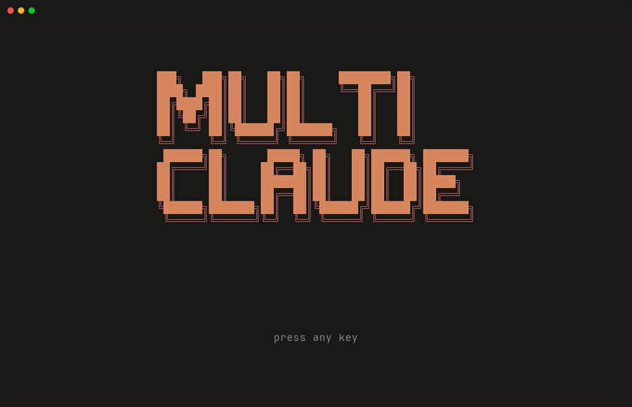
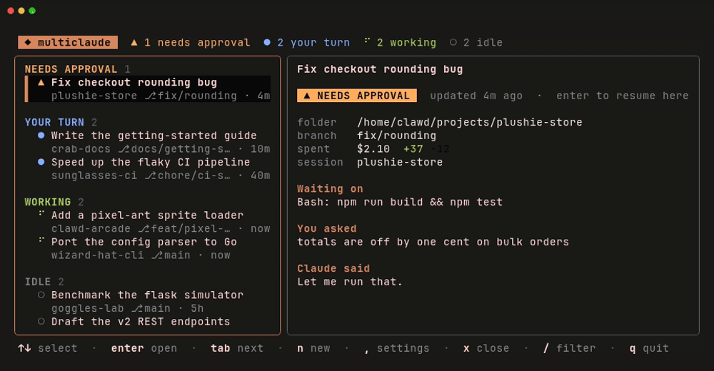
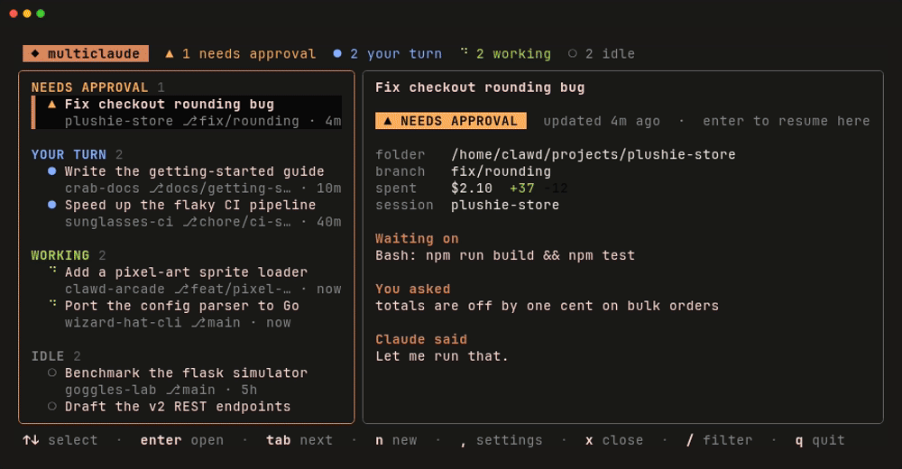
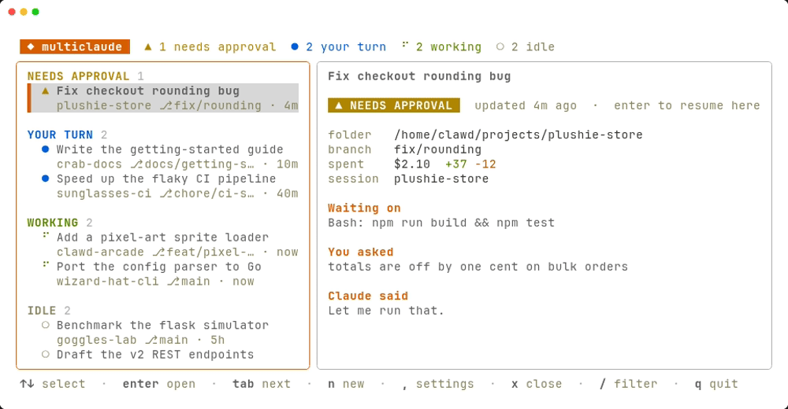

# multiclaude

<p align="center">
  <a href="#install">install</a> · <a href="#themes">themes</a> · <a href="#development">development</a>
</p>

<p align="center">
  <a href="https://github.com/roschreiber/multiclaude/stargazers"></a>
  <a href="https://github.com/roschreiber/multiclaude/commits/main"></a>
  
</p>

---

<p align="center"></p>

**the lightweight and sane way to manage multiple claude code sessions**

- **every session in a simple list**: multiclaude reads straight from your `~/.claude/projects`, so sessions you started outside of it show up too. there's nothing that you need to import or set up.
- **knows which ones need you**: sessions are sorted by status, so anything waiting on a tool approval or a reply sits at the top instead of getting lost somewhere at the bottom.
- **one go binary**: super simple with nothing extra to install. multiclaude works in the terminal of your choice, right from the start!

---

## install

```bash
go install github.com/roschreiber/multiclaude/cmd/multiclaude@latest
```

then start it anywhere by just running:

```bash
multiclaude
```

## easy UI to look at

the sidebar lists every session with its project and what it last did. move with the arrow keys or `j`/`k`, and press `/` to filter when the list gets too long.

<p align="center"></p>

## themes

press `,` to open the settings and pick a theme. there's support for light mode terminals too if you're like [that](https://www.youtube.com/watch?v=ybaK3y_6YXg)...

<p align="center"></p>

<p align="center"></p>

## development

```bash
git clone https://github.com/roschreiber/multiclaude
cd multiclaude
go build ./cmd/multiclaude
```
<sub align="center">Not affiliated with, endorsed by, sponsored by, or produced by Anthropic PBC. Claude is a trademark of Anthropic PBC.</sub>
